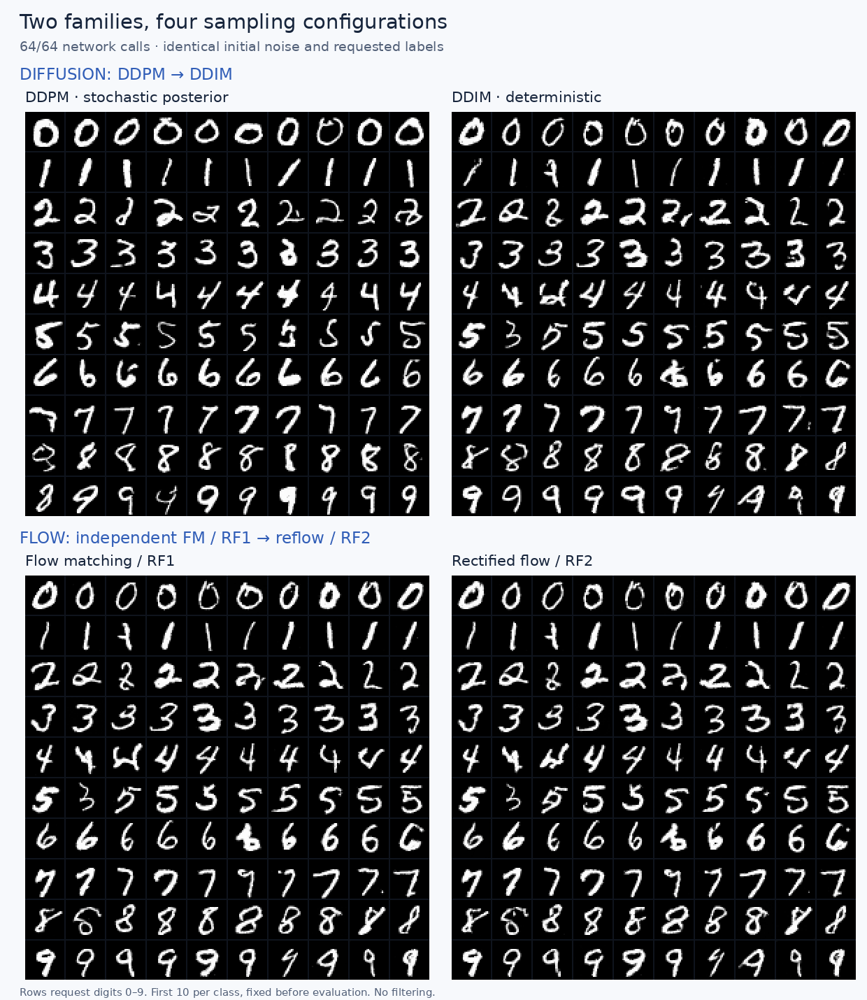
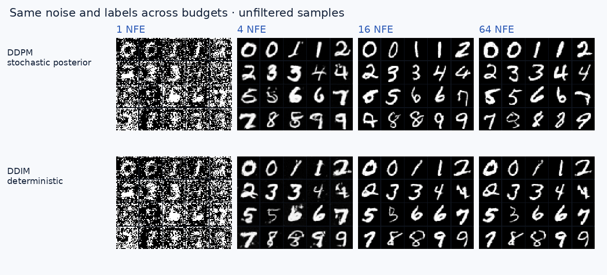
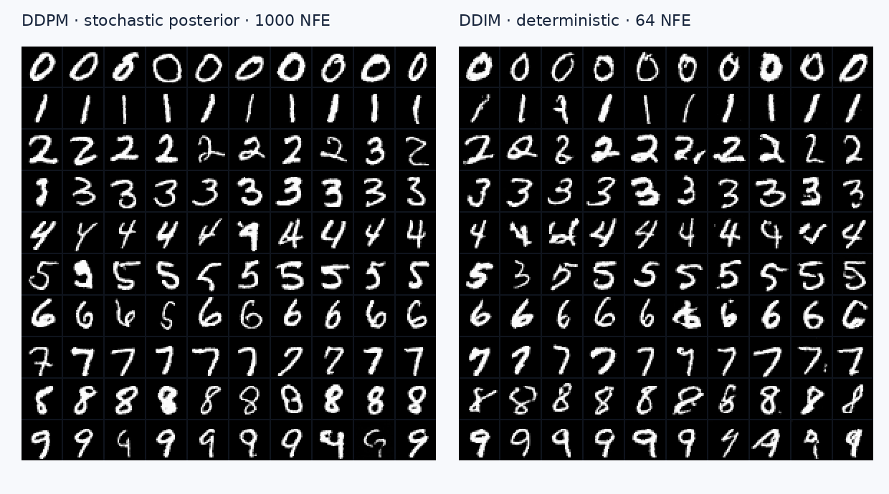
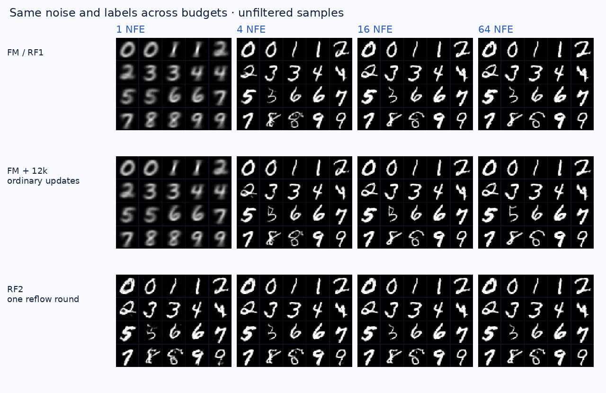
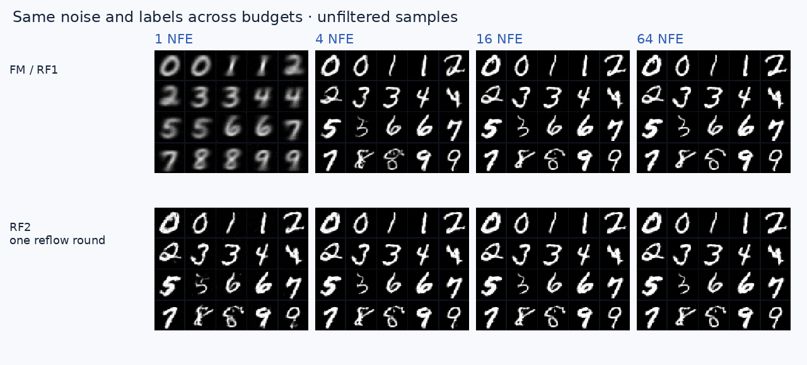
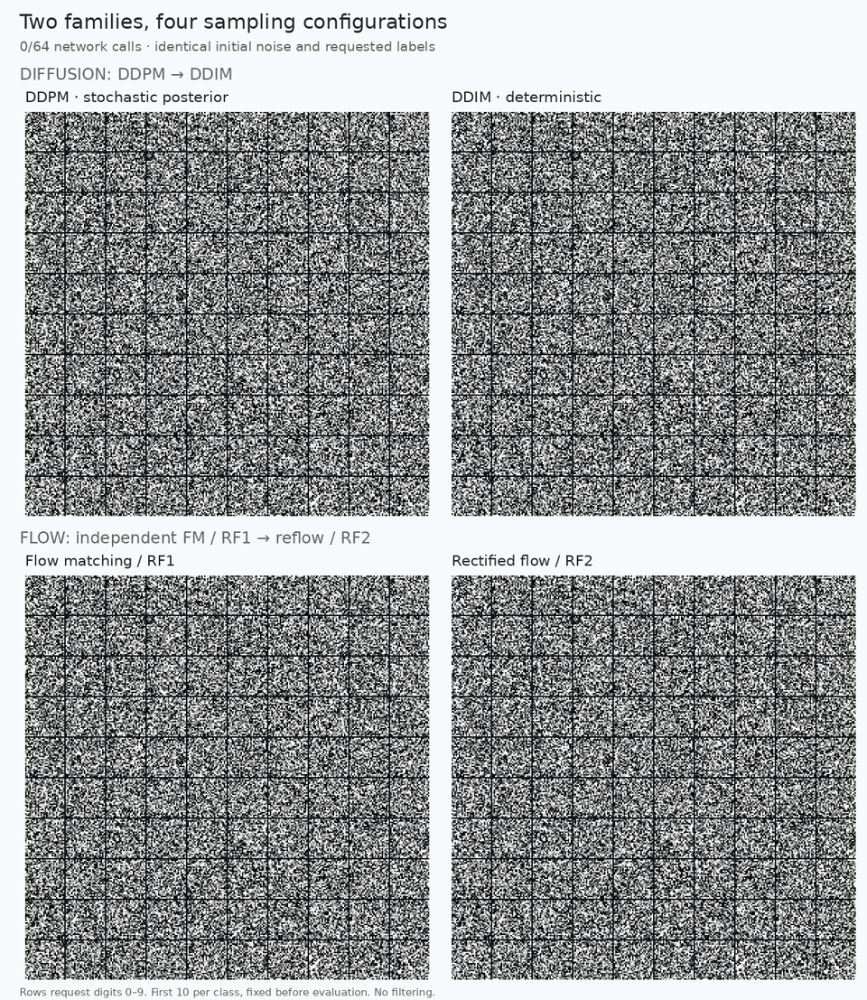
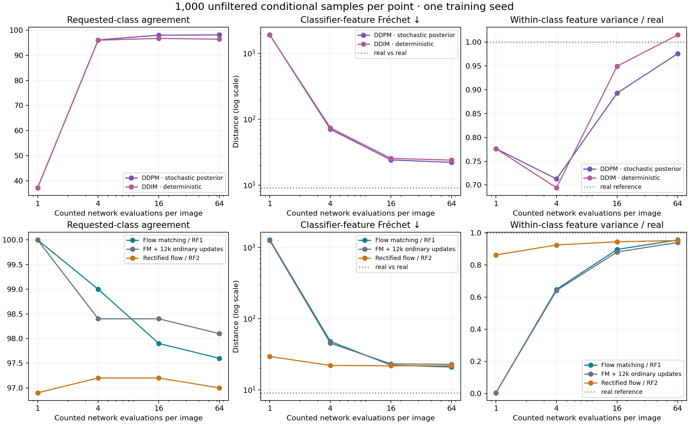
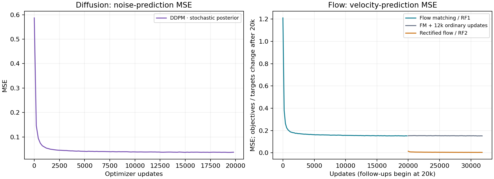

# Two Roads from Noise to Digits: DDPM → DDIM and Flow Matching → Reflow

A practical English tutorial for readers who know tensors and neural networks but have never written a complete generative-model training loop.

We will train small MNIST generators from scratch, read their code, watch their actual sampling trajectories, and make two improvements with different meanings:

- **Diffusion:** train one noise predictor with DDPM, then change its sampler to DDIM.
- **Flow:** train a straight-path flow matcher, also called the independent-pair first rectified flow here, then change its training pairs through **reflow**.

The four names describe four generation configurations. DDPM and DDIM share one checkpoint. FM/RF1 and the reflow student have separate checkpoints. An additional continued-training control helps us interpret reflow; it is not a fifth main method.

Everything below was generated by the accompanying code. No external generator weights, classifier guidance, or sample selection are used. All main comparisons use the same class-conditioned U-Net and the same noise inputs. The final experiment is separate from the earlier unconditional experiments preserved in this workspace.



Each panel contains the first ten evaluation samples requested for each digit. The indices were fixed before seeing any output. These are not the best ten images.

## 1. Read the repositories before comparing their pictures

Three useful references motivated this experiment: [orshkuri’s DDPM implementation](https://github.com/orshkuri/ddpm-mnist-diffusion/tree/cd7ee52d0d95ada16d7c17d87f85f6c6c1d83716), [Michedev’s flow matching implementation](https://github.com/Michedev/flow-matching-mnist/tree/7b93d690ea9e7fc545598203f2609884f8bd1eaa), and [minii-ai’s small rectified flow](https://github.com/minii-ai/smol-rectified-flow/tree/54418a15aa0c7892b8aec6c2b9dd6a7b97f0b88d). The links pin the exact audited versions.

Their screenshots are useful examples, but their defaults are different experiments:

| Source | What the code actually does | What matters when comparing |
|---|---|---|
| DDPM MNIST | Conditional denoiser; cosine corruption; ancestral and DDIM samplers | Upstream DDPM uses classifier-free guidance; its DDIM branch does not apply the same guidance |
| Flow matching MNIST | Unconditional default, optional conditional branch; adaptive `dopri5` | Two requested output times can require many network evaluations; CLI requests 10 epochs, notebook requests 100 |
| Smol rectified flow | Conditional U-Net; straight interpolation; backwards Euler | Resizes to 32×32, uses [0,1], and implements one flow training stage, without a reflow pair bank |

These are controlled reimplementations informed by the sources, not exact reproductions of three architectures or their galleries. We keep the mathematical ideas and use one backbone, image convention, conditioning scheme and training budget. The [detailed source audit](repository_audit.html) includes exact file links, default configurations, a tested assignment-helper issue in the optional FM branch, and what we changed.

A naming trap matters here. For the independent linear interpolation used in this tutorial, FM and the first rectified flow have the same regression objective, up to a time reversal in the smol code. Giving them two names does not create two different baselines. Our fourth configuration is a **second flow obtained by reflow**, an extension we implement explicitly.

## 2. What the model sees

A grayscale MNIST image is a tensor of shape `[1, 28, 28]`. A batch has shape `[B, 1, 28, 28]`. We map bytes from [0,255] into [-1,1]: black background becomes -1, white ink becomes +1. Gaussian starting noise has exactly the same shape.

Our network receives three inputs:

```python
prediction = model(x, t, y)
# x: [B, 1, 28, 28], partially generated / corrupted image
# t: [B], floating-point time
# y: [B], requested digit, integer 0 ... 9
# prediction: [B, 1, 28, 28]
```

The output is an image-shaped prediction, not ten classification scores. Its interpretation depends on training: diffusion predicts noise; flow predicts a velocity. The label tells the generator which digit to make. It does not specify stroke width, slant or handwriting style; noise should still produce variation within a class.

We deliberately use direct label conditioning throughout, with guidance scale one and no label dropout. There is one network forward per sampling step. Stronger classifier-free guidance could improve a gallery but would change diversity and usually require conditional and unconditional forwards. It belongs in a separate experiment.

Our [`DigitUNet`](digit_model.py) has 1,226,721 parameters:

```text
28×28, 32 channels ─────────────── skip ───────────────┐
       ↓ stride-2 convolution                        │
14×14, 64 channels ───────── skip ──────────┐          │
       ↓ stride-2 convolution             │          │
 7×7, 128 channels → attention             │          │
       ↑ resize + convolution → concatenate skip     │
14×14, 64 channels                                   │
       ↑ resize + convolution → concatenate skip ────┘
28×28, 32 channels → 1-channel output
```

The encoder extracts structure at smaller resolutions. Decoder skip connections preserve local detail. Attention at 7×7 lets each location see the entire digit, helping connect distant strokes. GroupNorm avoids dependence on other examples’ batch statistics. Sine/cosine time features pass through an MLP; a learned class embedding is added to them. Each residual block uses that combined vector to scale and shift its features.

This is intentionally a small U-Net rather than a DiT. It keeps training affordable and lets us isolate the generative process before introducing Transformer patch tokens.

## 3. The common training loop, line by line

All experiments follow the same supervised-learning structure. We manufacture a regression problem from real images and Gaussian noise:

```python
import torch
from torch.nn import functional as F
from digit_model import DigitUNet
from quality import dataset
from unified.processes import training_pair, cosine_schedule

torch.manual_seed(42)
model = DigitUNet(num_classes=10).cuda()
optimizer = torch.optim.AdamW(model.parameters(), lr=2e-4, weight_decay=1e-4)
alpha_bar = cosine_schedule(1000, device="cuda")

# One ordinary minibatch, for clarity; the full trainer balances classes.
images, labels = dataset("train")
images, labels = images.cuda(), labels.cuda()
indices = torch.randint(len(images), (128,), device="cuda")
data, y = images[indices], labels[indices]

noise = torch.randn_like(data)
t = torch.rand(len(data), device=data.device)
x, target, model_time = training_pair(
    data, noise, t, family="flow", abar=alpha_bar
)
prediction = model(x, model_time, y)
loss = F.mse_loss(prediction, target)

optimizer.zero_grad(set_to_none=True)
loss.backward()
torch.nn.utils.clip_grad_norm_(model.parameters(), 1.0)
optimizer.step()
```

`zero_grad` clears gradients accumulated by previous updates. `backward` differentiates the scalar loss through the network. Gradient clipping limits unusually large updates. `step` changes the weights. None of those operations runs during sampling.

This snippet shows the core mechanics; the full runnable trainer is [`unified/train.py`](unified/train.py). It adds balanced label sampling, dedicated random streams, learning-rate scheduling, exponential moving averages and resumable checkpoints. To train diffusion, the central change is `family="diffusion"`, which manufactures a different input and target. We explain both below before reading their samplers.

An **EMA** is a slowly changing copy of the parameters:

```python
with torch.no_grad():
    for average, current in zip(ema.parameters(), model.parameters()):
        average.lerp_(current, 1 - decay)
```

It averages recent training iterates and often gives more stable samples. We evaluate EMA weights for every configuration, rather than quietly giving only one method this benefit. This experiment uses FP32 on a V100.

## 4. Diffusion, first step: train DDPM to predict noise

Imagine covering an image with increasingly strong Gaussian noise. Let `d` denote a clean digit and `epsilon` an independent standard Gaussian image. At discrete corruption index `k`:

\[
x_k = \sqrt{\bar\alpha_k}\,d + \sqrt{1-\bar\alpha_k}\,\epsilon.
\]

The scalar `alpha_bar[k]` is the fraction of signal variance remaining. Near the clean end it is close to one; near the noisy end it is close to zero. We use a 1,000-step cosine schedule. It ends at approximately 2.43×10⁻⁹, so terminal inputs are almost pure noise.

The [DDPM paper](https://arxiv.org/abs/2006.11239) motivates a reverse denoising chain. Here the practical training objective is the familiar noise-prediction MSE:

\[
\mathcal L_{\mathrm{diff}} = \mathbb E_{d,y,\epsilon,k}
\left[\|\epsilon_\theta(x_k,(k+1)/T,y)-\epsilon\|^2\right].
\]

The following is the diffusion branch of our common problem builder:

```python
# t is uniform in [0, 1); use it to select a discrete index.
k = (t * len(alpha_bar)).long().clamp_max(len(alpha_bar) - 1)
a = alpha_bar[k].view(-1, 1, 1, 1)
x = a.sqrt() * data + (1 - a).sqrt() * noise
target = noise
model_time = (k + 1).float() / len(alpha_bar)
```

Why does this learn a useful prediction if the network never sees `data`? Because it sees many pairs of corrupted images and their known injected noise. Minimizing squared error estimates a conditional average of that noise given the available image, time and class. At ambiguous noisy inputs, it cannot identify the exact training image that was used. Sampling progressively resolves that ambiguity.

Training does **not** require running a 1,000-step chain. One update samples one corruption index per image and makes one network prediction. The long loop comes at generation time.

### From a noise prediction to a cleaner image

Solving the corruption equation for `d` gives an estimate:

\[
\hat d = \frac{x_k-\sqrt{1-\bar\alpha_k}\,
\epsilon_\theta(x_k,k,y)}{\sqrt{\bar\alpha_k}}.
\]

At very noisy times, the denominator is tiny. An imperfect prediction can imply implausibly large clean pixels. We clip `d_hat` to [-1,1] in **both** diffusion samplers and recompute the noise consistent with that clipped estimate. We do not clamp intermediate states, which still contain Gaussian noise.

Ancestral DDPM sampling combines the current prediction with fresh random noise to move to a less corrupted state. Repeating this many times produces the sample. Given identical starting noise, DDPM can produce a different final image when its later random draws change.

### Native DDPM versus a respaced chain

Our native reference visits all 1,000 corruption indices. For an equal-cost comparison with 64-step flow, we also evaluate a **64-NFE respaced DDPM posterior sampler**. It uses a selected index grid and the posterior formula appropriate to those larger jumps. It does not skip indices while blindly retaining the adjacent-step coefficients.

This distinction prevents an unfair claim that “DDPM costs 1,000 while everything else costs 64” without showing its reduced-budget behavior.

## 5. Diffusion, next step: DDIM changes sampling, not training

DDIM asks whether the same trained noise predictor can generate along a more deterministic path. We keep the checkpoint, labels, starting noise, selected indices, clipping and image convention unchanged. We change one sampler parameter: how much fresh noise to inject.

For a current signal variance `a` and the next, cleaner signal variance `b`, where `b > a`, define:

\[
\sigma = \eta\sqrt{\frac{1-b}{1-a}\left(1-\frac{a}{b}\right)},
\qquad
x_{\mathrm{next}} = \sqrt b\,\hat d +
\sqrt{1-b-\sigma^2}\,\hat\epsilon + \sigma\,\xi.
\]

Here `xi` is fresh standard Gaussian noise. The final update uses exactly `b = 1`, meaning a clean endpoint. In our implementation:

- `eta = 1` gives posterior sampling on the selected diffusion grid. On all 1,000 adjacent indices, this is native posterior-variance DDPM.
- `eta = 0` removes the fresh-noise term, giving deterministic DDIM on that grid.

This is the useful connection described by the [DDIM paper](https://arxiv.org/abs/2010.02502): a different generation procedure can reuse the denoiser trained by the same objective. DDIM is not another training run in our results.

```python
# Schematic single step; see unified/processes.py for the complete loop.
clean = ((x - (1-a).sqrt() * predicted_noise) / a.sqrt()).clamp(-1, 1)
epsilon = (x - a.sqrt() * clean) / (1-a).sqrt()
sigma = eta * ((1-b)/(1-a) * (1-a/b)).clamp_min(0).sqrt()
x_next = b.sqrt()*clean + (1-b-sigma.square()).clamp_min(0).sqrt()*epsilon
x_next = x_next + sigma * fresh_noise
```

With one selected time point our two diffusion samplers are identical: both must jump directly from the terminal noise index to the clean endpoint, and `sigma = 0`. At such an extreme noise level, small denoising errors are strongly amplified. One-step results should be inspected, not expected to work because the formula is valid.



Each mini-grid contains the first two samples requested for each class, in digit order. Columns change the actual number of network calls, not the training budget. Compare both sample quality and how stable each method is as calls decrease.



This second figure is a practical quality/cost reference with unequal inference budgets; the main four-way grid above is the matched-64-NFE comparison.

## 6. Flow, first step: learn where pixels should move

Now start from the same Gaussian image `z`, but connect it to a real digit `d` with a straight line:

\[
x_t=(1-t)z+t d,\qquad t\in[0,1].
\]

In this convention, time zero is noise and time one is data. Differentiate with respect to time:

\[
\frac{d x_t}{dt}=d-z.
\]

The derivative is an image-shaped velocity. If one pixel must travel from -0.2 to +0.8 over a unit interval, its prescribed velocity on that particular training line is +1.0. The training code is short:

```python
t_image = t[:, None, None, None]
x = (1 - t_image) * noise + t_image * data
target = data - noise
prediction = model(x, t, y)
loss = F.mse_loss(prediction, target)
```

`t_image` has shape `[B,1,1,1]`: broadcasting applies each example’s scalar time to all of its pixels. The mean-squared error averages over examples and pixels.

The general [Flow Matching framework](https://arxiv.org/abs/2210.02747) allows more choices of probability path. This tutorial studies the simple independent-endpoint, straight interpolation case. “Conditional” in conditional flow matching means conditioning the training path on its endpoints; that use of the word is separate from conditioning our network on a digit label.

### Why are straight training lines not straight generated trajectories?

The network sees `x`, `t` and the requested class; it does not see the particular endpoint pair that created `x`. Several training lines can pass through nearby states with different velocities. The squared-error optimum averages the possible targets:

\[
v^*(x,t,y)=\mathbb E[d-z\mid x_t=x,t,y].
\]

Following that shared field solves an ODE:

\[
\frac{dX_t}{dt}=v_\theta(X_t,t,y),\qquad X_0\sim\mathcal N(0,I).
\]

Although every supervised endpoint interpolation was straight, an ODE trajectory through the learned average field can curve. This distinction explains why multiple sampling steps remain useful.

Euler integration is the simplest sampler:

```python
@torch.no_grad()
def euler_sample(model, noise, labels, steps=64):
    x = noise.clone()
    for k in range(steps):
        t = torch.full((len(x),), k / steps, device=x.device)
        x = x + model(x, t, labels) / steps
    return x
```

We predict at the current state, move a small distance, then ask for a new velocity. There is no fresh random noise after initialization. With one prediction per iteration, 64 iterations mean exactly 64 network function evaluations, or **NFE**.

Do not interpret the interpolation formula as the sampler: `x = (1-t)*noise + t*data` requires a known real image. Generation has no such image; it repeatedly queries the learned field.

### A useful surprise: one-step FM can become a blurry class prototype

At `t = 0`, `x = z`. Independent pairing makes the real image independent of `z` given the requested label. In the ideal regression solution:

\[
v^*(z,0,y)=\mathbb E[d\mid y]-z,
\qquad z+v^*(z,0,y)=\mathbb E[d\mid y].
\]

A single Euler step therefore points toward the **average image of that digit**, which loses handwriting variation. Finite neural training only approximates this endpoint behavior, because exact `t=0` has measure zero under the continuous training distribution. Nevertheless, it explains why a recognizable one-step digit can still be blurry and nearly identical across different noise inputs.

A classifier can give that prototype a high digit score. That is why requested-class accuracy alone cannot establish successful generation. We also inspect unfiltered grids, feature distance and variation within each requested class.

## 7. Where Rectified Flow fits—and what reflow changes

The [Rectified Flow paper](https://arxiv.org/abs/2209.03003) learns velocity fields from endpoint interpolations and studies repeated rectification of the endpoint coupling. Its independent-pair first stage matches the straight-path objective above. The smol repository uses the reverse convention:

```text
smol:  time 0 = data, time 1 = noise, target = noise - data
ours:  time 0 = noise, time 1 = data, target = data - noise
```

Substitute `s = 1 - t` and negate the drift. The training problem and Euler direction agree. Our numerical tests check this equivalence. RF1 is not a new loss that mysteriously improves FM by changing its name.

### Reflow changes the pairing

Independent FM chooses a real image without regard to its sampled noise. Reflow instead creates a meaningful pairing with a frozen teacher:

1. Draw Gaussian noise `z` and a requested class `y`.
2. Integrate the trained FM teacher for 128 Euler calls to obtain `d_teacher`.
3. Store `(z, d_teacher, y)` as one paired example.
4. Fit another flow to the straight interpolation between those **paired** endpoints.

```python
# Pair generation: a separate, explicitly costed stage.
with torch.no_grad():
    endpoint = euler_sample(teacher, noise, labels, steps=128)
# Save noise, endpoint, and labels together. Never shuffle them independently.

# Student training: same regression machinery, new joint distribution.
x = (1 - t_image) * paired_noise + t_image * teacher_endpoint
target = teacher_endpoint - paired_noise
loss = F.mse_loss(student(x, t, labels), target)
```

The marginal endpoint distribution is the teacher’s generated distribution, rather than the real training distribution. Crucially, the endpoint is now associated with its starting noise. The desired mapping is no longer “average all possible real images paired with this noise.” It approximates the teacher’s particular noise-to-image mapping.

That can make a coarse solver more useful. It does not create information missing from the teacher, guarantee better high-budget image quality, or turn a finite neural student into an exact theoretical flow. Teacher errors, a finite pair bank and optimization error all remain.

Our **RF2** uses one reflow round: 20,000 balanced stored pairs, a frozen base-flow EMA teacher, and 12,000 student updates at batch size 128. We initialize the student from the same teacher EMA and use learning rate 1e-4. The smol source does not implement this pair-generation stage; this is our added experiment.

### Did reflow help, or did we merely train longer?

We also initialize another student from the identical teacher EMA and train it for 12,000 ordinary independent-FM updates. It has the same optimizer, learning rate, EMA decay and requested-class sequence as the reflow student. This **continued FM** control receives more real examples instead of the teacher’s fixed paired bank.



This controls for additional optimizer updates and warm initialization. Total compute is still unequal: reflow also paid to generate its pair bank. The control is a diagnostic, not a reason to hide that cost. See the measured results below before deciding whether a particular improvement came from pairing or additional training.



## 8. Watch the actual generation, grouped by family



The top row contains stochastic DDPM and deterministic DDIM. The bottom contains independent FM/RF1 and its reflow student. Every displayed image starts from its corresponding identical noise tensor and requested label. Frames come from the actual sampler states; they are not a visual morph between a noisy image and a final digit.

The progress counter means **fraction of the 64 network evaluations completed**. It does not mean that a cosine diffusion noise level equals a linear-flow time. DDPM introduces fresh noise at intermediate steps; DDIM and both Euler flows remain deterministic given initial noise and labels.

The MP4 embedded in the HTML can be paused and scrubbed. The local GIF is available as a fallback. No automatic playback is required.

## 9. Compare the families without false shortcuts

| Question | Diffusion experiment | Flow experiment |
|---|---|---|
| How is a training input built? | Cosine signal/noise mixture | Linear endpoint interpolation |
| What is regressed? | Injected Gaussian noise | Endpoint displacement / path velocity |
| Does a training update integrate a generation trajectory? | No | No |
| What changes in the second configuration? | DDIM changes the sampler | Reflow changes the coupling and trains a student |
| Is generation stochastic after initialization? | Posterior DDPM yes; DDIM here no | Euler FM and RF2 here no |
| Where does the training target come from? | Real image plus sampled noise | Real image for FM; a paired teacher endpoint for RF2 |

“Diffusion is random, flow is deterministic” is too broad: our DDIM is deterministic too. “Flow trains without simulation, unlike diffusion” is also misleading here: both base training loops manufacture one noisy state directly. Reflow does add a separately costed teacher-integration stage.

### An optional mathematical bridge

Choose a continuous noise-to-data clock and a Gaussian path

\[
x_t=a(t)d+b(t)\epsilon.
\]

Its conditional velocity is `a_dot * d + b_dot * epsilon`. Taking conditional expectations and eliminating the unknown clean image yields, wherever `a(t)` is nonzero,

\[
v(x,t,y)=\frac{\dot a(t)}{a(t)}x+
\left(\dot b(t)-\frac{\dot a(t)}{a(t)}b(t)\right)
\mathbb E[\epsilon\mid x_t=x,y].
\]

Thus, an ideal noise predictor and an ideal velocity predictor can be related for the **same Gaussian path**. With independent Gaussian corruption, the score is likewise `-E[epsilon | x,t,y] / b(t)` when `b(t) > 0`. Endpoint singularities require care; these expressions are not instructions to divide by zero in code.

This connection does not make our two trained checkpoints identical. We use different paths, time weighting and output parameterizations, and finite networks only approximate conditional expectations. It explains why diffusion ODEs and flow matching belong to a connected set of ideas rather than completely separate worlds. The broad Gaussian-path perspective is developed in [Flow Matching for Generative Modeling](https://arxiv.org/abs/2210.02747).

## 10. A controlled experiment: what was held fixed

| Item | Protocol |
|---|---|
| Data | Official MNIST 60,000-image training split; original 28×28 resolution; [-1,1] |
| Classes | Uniform requested digit sampling, then a uniform real example within that digit |
| Network | Identical 1,226,721-parameter conditional U-Net |
| Base training | 20,000 updates × 128 images = 2.56 million presentations, about 42.67 dataset-equivalents |
| Shared random streams | Same initial weights, real-image batches, Gaussian noise, and uniform time draws for the two base objectives |
| Optimizer | AdamW, weight decay 1e-4; peak learning rate 2e-4; 1,000-update warmup; cosine decay to 2e-5; gradient clipping 1 |
| Evaluation weights | EMA, maximum decay .999; adaptive early decay for base runs |
| Follow-ups | Both start from teacher EMA; 12,000 updates; AdamW at 1e-4; EMA .999 |
| Main sampling budget | 64 counted forwards per image for all four configurations; no CFG |
| Budget sweep | 1, 4, 16, 64 NFE; native DDPM at 1,000 NFE separately |
| Evaluation inputs | 1,000 fixed Gaussian images; 100 requested samples per class; seed 2026 |
| Visual selection | First ten per class for main figures; first two per class for budget figures |
| Hardware | Shared Tesla V100, FP32; one training seed |

The same uniform time draws do not imply the same signal-to-noise weighting: cosine diffusion and linear interpolation intentionally define different problems. The objectives and sampler equations are the things we are comparing.

We save initial-weight hashes, checkpoint hashes, random generator states and per-class presentation counts. Evaluation checks that base initial weights and class streams match, follow-up initial weights and class streams match, DDPM/DDIM reuse one checkpoint, and every visual sample appears in the metric set. Exact cross-hardware bitwise reproducibility is not claimed.

### Read several diagnostics together

Our independent small MNIST classifier reaches **98.89% accuracy on the official test split**. It was trained separately and is never used to guide generation or discard images. For every configuration/budget we retain and evaluate all 1,000 outputs.

**Requested-class agreement** asks whether the classifier predicts the requested label. It is interpretable for conditional generation, but prototypes, artifacts and classifier mistakes can inflate it. It is not human-rated digit validity.

**Classifier-feature Fréchet distance** compares means and covariances in that classifier’s 128-dimensional feature space against 1,000 held-out real images, 100 per class. Lower is better under this representation. It is **not Inception FID**, and its absolute scale should not be compared with published FID scores. A second balanced real subset provides a finite-sample real-versus-real reference.

**Within-class variance ratio** compares generated feature or pixel variation with real variation after subtracting each class mean. A near-zero ratio signals little variety within a requested digit. A ratio near one is not proof of correct diversity: malformed images can also be variable. The grids and other diagnostics are essential.

All metrics use an explicit [-1,1] display projection of the final image. Flow integration itself remains unclipped; diffusion only clips its predicted clean image. No metric is a complete perceptual assessment.

### Diffusion family: same denoiser, different sampler

| Configuration | NFE | Requested-class agreement ↑ | Classifier-feature Fréchet ↓ | Within-class feature variance / real | Seconds / 1,000 images |
|---|---:|---:|---:|---:|---:|
| DDPM (respaced posterior) | 64 | 98.1% | 22.18 | 0.976 | 3.36 |
| DDIM (same checkpoint) | 64 | 96.4% | 23.94 | 1.015 | 3.26 |

The separate native 1,000-NFE DDPM reference obtains **96.1%** requested-class agreement and feature distance **21.11**, taking **52.23 seconds** for 1,000 outputs. The 64-NFE table changes only the sampler; it cannot be interpreted as a comparison between independently trained denoisers.

At the matched 64-call budget, DDPM and DDIM have very similar runtime because they execute the same network the same number of times. The practical native-chain comparison uses 16.0× less measured sampling time for DDIM at 64 calls, with the quality tradeoffs shown above. Respaced DDPM also supports this reduced budget. DDIM does not guarantee better quality at equal NFE, and more reverse steps need not monotonically increase a classifier score. One seed cannot establish the significance of small differences.

### Flow family: change the coupling, with a continuation control

| Configuration | NFE | Requested-class agreement ↑ | Classifier-feature Fréchet ↓ | Within-class feature variance / real | Seconds / 1,000 images |
|---|---:|---:|---:|---:|---:|
| FM / RF1 | 64 | 97.6% | 20.93 | 0.956 | 3.04 |
| FM + 12k ordinary updates | 64 | 98.1% | 22.87 | 0.941 | 3.05 |
| RF2 (one reflow round) | 64 | 97.0% | 21.79 | 0.952 | 3.05 |

The equal-follow-up-budget comparison is continued FM versus RF2. Both start from the same base EMA and receive 12,000 updates. At low NFE, also inspect whether increased class agreement comes with preserved variation:

| NFE | FM agreement / variance ratio | Continued FM agreement / variance ratio | RF2 agreement / variance ratio |
|---:|---:|---:|---:|
| 1 | 100.0% / 0.005 | 100.0% / 0.005 | 96.9% / 0.863 |
| 4 | 99.0% / 0.649 | 98.4% / 0.641 | 97.2% / 0.925 |
| 16 | 97.9% / 0.897 | 98.4% / 0.881 | 97.2% / 0.945 |
| 64 | 97.6% / 0.956 | 98.1% / 0.941 | 97.0% / 0.952 |

**Read one-step FM carefully:** it scores **100.0%** requested-class agreement while its within-class feature variance is **0.005×** the real reference and its feature distance is **1276.57**. In this run it largely produces class prototypes, and ordinary continued training retains this behavior. RF2 reaches **0.863×** within-class feature variance and feature distance **29.43** in one call, with **96.9%** agreement. Read the lower class score alongside its more meaningful visual variation.

At four calls, RF2’s feature distance is **22.03**, compared with **47.94** for base FM and **45.16** for equally long continued FM. At 64 calls, the comparison is **21.79 versus 20.93** for RF2 and base FM. These measurements support a coarse-integration benefit in this experiment, with extra training and teacher-generation cost; they do not show a high-budget feature-distance improvement.

A higher agreement score is useful only alongside plausible images and variation. Reflow primarily aims to preserve a teacher mapping under coarse integration, not to maximize a classifier score. These measurements describe one training seed; they do not establish a universal ordering of the methods.

The finite-sample real-versus-real feature-distance reference is **9.10**. On the 1,000-image real reference, requested-class agreement is **98.5%**.

### Training and teacher costs

| Stage | Updates | Seconds | What the cost includes |
|---|---:|---:|---|
| diffusion | 20,000 | 415.4 | Optimizer updates, EMA and periodic saves |
| flow | 20,000 | 410.5 | Optimizer updates, EMA and periodic saves |
| reflow | 12,000 | 252.1 | Optimizer updates, EMA and periodic saves |
| continued | 12,000 | 258.5 | Optimizer updates, EMA and periodic saves |
| Teacher pair generation | — | 133.3 | 20,000 pairs × 128 teacher NFE |

Reflow’s total cost includes base-flow training, teacher-bank generation and student fitting. Continued FM includes base-flow training and its extra real-data updates. DDIM has no additional training cost beyond the diffusion checkpoint. The 1,000-sample evaluation cost is separate from these training costs.

For the three flow checkpoints, the measured dense-path constant-velocity defects (lower means closer to constant velocity along the integrated path, not a quality score) are **FM / RF1: 0.0336**, **FM + 12k ordinary updates: 0.0329**, **RF2 (one reflow round): 0.0015**. They use the same 100 visual inputs and 128 Euler calls.




Timing measures generation plus output transfer for 1,000 images in batches of 100. Warmup, classifier evaluation and animation recording are excluded. These are single measurements on a shared GPU, useful for interpreting this run rather than a controlled hardware benchmark. Training times cover retained training segments; queue waiting and work discarded after an interrupted checkpoint interval are excluded.

### What the training curves can and cannot tell us



Diffusion learns noise; flow learns displacement. Their targets have different distributions and scales, so a lower raw MSE in one panel does not prove a better generator. Reflow also changes the endpoint distribution and the coupling, so a student’s lower regression loss is not by itself a sample-quality result. Use loss to check training progress, then inspect fixed-noise samples and independent diagnostics.

## 11. Why the previous weak digits were not a verdict on flow matching

The earlier experiment combined a smaller unconditional network, a short training budget and different sampling choices. Some referenced repositories instead use class labels, larger architectures, longer notebook training or guidance. Those factors can substantially change a gallery. Comparing those outputs as if only the mathematical objective changed would be misleading.

The current experiment adds global image context, explicit class conditioning, a longer controlled optimization budget, EMA weights and consistent sampling accounting. Because these changes were bundled, we cannot assign a causal percentage of improvement to any one of them. A proper single-variable architecture or conditioning ablation would require additional matched runs.

When debugging your own generator, check concrete invariants before changing the method name:

1. Inspect normalized real images and their labels. A wrong range or label alignment breaks the learning problem.
2. Check endpoint conventions: does `t=0` mean noise or data? Does the regression sign agree with the integration direction?
3. For diffusion, check that the forward coefficients match training and sampling, and that the final update reaches the clean endpoint.
4. Verify shape and finite gradients, and inspect a fixed-noise grid as training progresses. A decreasing scalar loss is insufficient.
5. Compare at actual network calls. Adaptive output times, guided steps and plain Euler iterations count differently.
6. For reflow, keep noise/endpoints/labels paired, freeze the teacher, and retain a continued-training control.

These checks explain failures; no training recipe guarantees every sample will be recognizable.

## 12. Reproduce the experiment on a V100

Install the listed dependencies into a CUDA-enabled PyTorch environment:

```bash
pip install -r requirements.txt
python -m unittest unified.test_unified -v
```

MNIST is downloaded directly as official IDX gzip files on first use; torchvision is not required. Cached files are reused. Use a scheduled GPU allocation, not a cluster login node. On the DTU environment used here, an interactive allocation was obtained with:

```bash
bsub -Is -J mnist_tutorial -q gpuv100i -n 4 \
  -R "span[hosts=1] rusage[mem=8GB]" \
  -gpu "num=1:mode=shared:j_exclusive=no" bash
```

Inside the allocation, run base training:

```bash
python -m unified.train --stage diffusion --steps 20000
python -m unified.train --stage flow --steps 20000
```

Then create the teacher bank and train the two follow-ups:

```bash
python -m unified.train --stage pairs --pairs 20000 --teacher-nfe 128
python -m unified.train --stage reflow --steps 12000
python -m unified.train --stage continued --steps 12000
```

These commands are sequential dependencies, not a promise they fit inside one lease. This queue assigns 15-minute interactive leases. Split work across allocations. Training saves every 2,000 updates; after interruption, repeat the same stage with `--resume`, keeping the original planned `--steps`. The trainer restores optimizer, EMA, data/noise/time streams and random states. Do not generate teacher pairs from an unfinished flow checkpoint.

```bash
# Example only if this stage was interrupted:
python -m unified.train --stage flow --steps 20000 --resume
```

Train the independent diagnostic classifier if its local checkpoint is absent:

```bash
python quality.py --help
python quality.py --train-classifier
```

Then evaluate on a GPU and render/export on a CPU:

```bash
python -m unified.evaluate
python -m unified.render
python optimize_assets.py unified_generation
python -m unified.publish
python build_article.py
python build_article.py --source comparison.md --output comparison.html
python build_article.py --source repository_audit.md --output repository_audit.html
```

The evaluator saves raw, unfiltered endpoint tensors for every budget, actual trajectories, input-bank hashes and [`report.json`](results/unified/evaluation/report.json). The renderer consumes these saved tensors; it does not generate a new gallery with a more favorable seed. The article publisher reads that same report to insert measured tables.

Tests check source time-reversal equivalence, an oracle diffusion sampler at several budgets including 1,000 calls, actual sampler call counts, conditional-network gradients and a counterexample to the audited assignment helper. They test mathematical invariants rather than asserting that one trained model must outperform another.

To publish the article, upload `index.html`, `comparison.html`, `repository_audit.html`, `assets/`, the linked source files and the linked report using the same relative layout. MathJax loads from a CDN. Keep the source/download links or change them to your repository URLs. The supplied archive preserves the required layout.

## 13. What to understand before moving on to DiT or video

You should now be able to read a training loop and answer four questions: How was its noisy input constructed? What does its network output mean? Which distribution supplies its paired endpoints? How does its sampler turn predictions into the next state?

In the diffusion family, DDIM changes the inference procedure while preserving the trained denoiser. In the flow family, reflow changes the training coupling and creates a new student. Neither improvement can be understood by comparing names or a single loss number.

Before scaling this to DiT, try replacing one component at a time: the U-Net with a patch Transformer, the pixel space with a learned latent space, or Euler with a higher-order solver whose actual calls you count. For video, the same questions persist, but temporal structure, latent compression and compute make careful controls even more valuable.

The original papers provide the broader context: [DDPM](https://arxiv.org/abs/2006.11239), [DDIM](https://arxiv.org/abs/2010.02502), [Flow Matching](https://arxiv.org/abs/2210.02747), and [Rectified Flow](https://arxiv.org/abs/2209.03003). The [source audit](repository_audit.html) connects this tutorial to the three concrete MNIST implementations.
